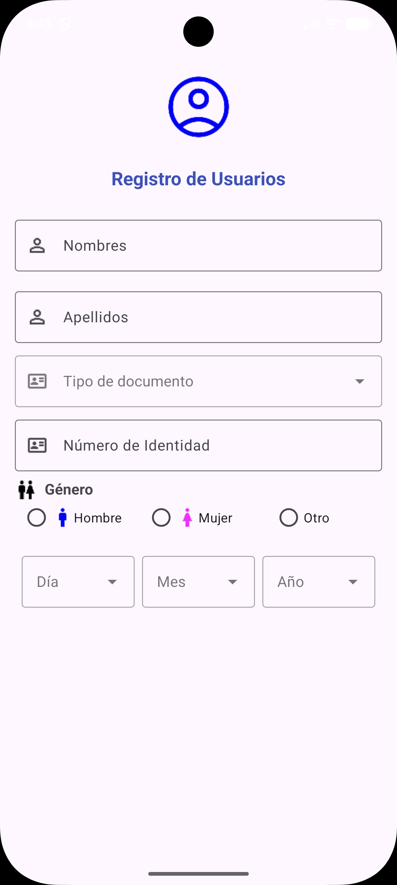
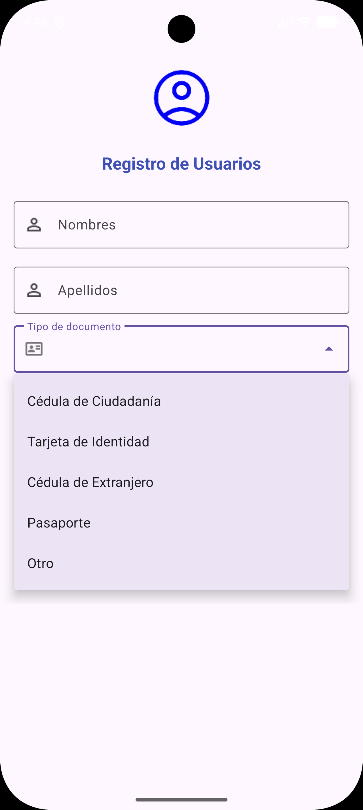
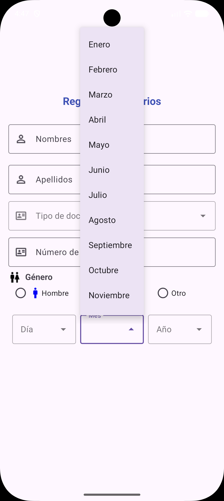
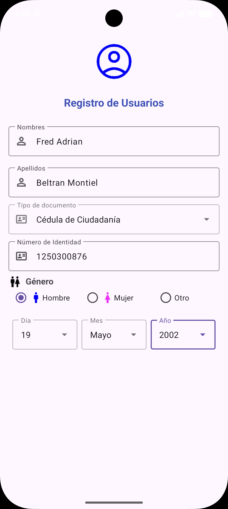

# Android_STD_User_Reg
Práctica de Aplicaciones Móviles – Pantalla con formulario de registro de usuario (User register) en Android Studio.

# Práctica: Registro de Usuario en Android Studio

**Asignatura:** Aplicaciones Móviles  
**Docente:** Ing. Cristian Gabriel Zambrano Vega  
**Estudiante:** Fred Adrián Beltrán Montiel  
**Curso:** 6to Software "A" – Universidad Técnica Estatal de Quevedo (UTEQ)  
**Fecha de la práctica:** 06/11/2026

## Descripción
Práctica guiada en la que se diseña un formulario de registro de usuarios en una sola pantalla (`MainActivity`). El diseño usa un `ScrollView` con un `ConstraintLayout` dentro, para que el formulario pueda desplazarse en pantallas pequeñas, y componentes de Material Design.

El formulario contiene:

- **Encabezado:** imagen de usuario y el título "Registro de Usuarios".
- **Nombres y Apellidos:** campos `TextInputLayout` con ícono.
- **Tipo de documento:** menú desplegable (`ExposedDropdownMenu` con `AutoCompleteTextView`) con las opciones Cédula de Ciudadanía, Tarjeta de Identidad, Cédula de Extranjero, Pasaporte y Otro.
- **Número de identidad:** campo de texto con ícono de credencial.
- **Género:** `RadioGroup` horizontal con los `RadioButton` Hombre, Mujer y Otro, cada uno con su ícono.
- **Fecha de nacimiento:** tres menús desplegables en fila (`LinearLayout` con pesos) para Día (1–31), Mes (Enero–Diciembre) y Año (1990–2020).

Las opciones de los menús desplegables se definen como `string-array` en `res/values/strings.xml` y se cargan con `app:simpleItems`.

## Estructura del proyecto
```
app/src/main/
├── java/com/uteq/software/appregistrousuario_is2026/
│   └── MainActivity.java      # Actividad del formulario
├── res/
│   ├── layout/
│   │   └── activity_main.xml  # Diseño del formulario de registro
│   ├── values/
│   │   └── strings.xml        # Listas: tipos de documento, días, meses y años
│   └── drawable/              # Íconos: usuario, nombre, credencial, género, hombre, mujer, etc.
└── AndroidManifest.xml
```

## Capturas de la interfaz

### Formulario de registro


### Menú de tipo de documento


### Selección de fecha de nacimiento


### Formulario completo


## Tecnologías utilizadas
- Android Studio Rabbit 2 (2026.2.2)
- Java 11
- Android Gradle Plugin 9.5.1 (Kotlin DSL para los scripts de Gradle)
- SDK mínimo 34 (Android 14) · SDK objetivo 37
- AndroidX AppCompat, ConstraintLayout y Material Components

## Cómo ejecutar
1. Clonar el repositorio:
   ```bash
   git clone https://github.com/JirachinG19Stdio/Android_STD_User_Reg.git
   ```
2. Abrirlo en Android Studio y esperar la sincronización de Gradle.
3. Ejecutar en un emulador o dispositivo físico con Android 14 o superior.

## Estado
✅ Práctica completada.
